COVID-19
================
Trevor McDonald
2026-10-12

- [Grading Rubric](#grading-rubric)
  - [Individual](#individual)
  - [Submission](#submission)
- [The Big Picture](#the-big-picture)
- [Get the Data](#get-the-data)
  - [Navigating the Census Bureau](#navigating-the-census-bureau)
    - [**q1** Load Table `B01003` into the following tibble. Make sure
      the column names are
      `id, Geographic Area Name, Estimate!!Total, Margin of Error!!Total`.](#q1-load-table-b01003-into-the-following-tibble-make-sure-the-column-names-are-id-geographic-area-name-estimatetotal-margin-of-errortotal)
  - [Automated Download of NYT Data](#automated-download-of-nyt-data)
    - [**q2** Visit the NYT GitHub repo and find the URL for the **raw**
      US County-level data. Assign that URL as a string to the variable
      below.](#q2-visit-the-nyt-github-repo-and-find-the-url-for-the-raw-us-county-level-data-assign-that-url-as-a-string-to-the-variable-below)
- [Join the Data](#join-the-data)
  - [**q3** Process the `id` column of `df_pop` to create a `fips`
    column.](#q3-process-the-id-column-of-df_pop-to-create-a-fips-column)
  - [**q4** Join `df_covid` with `df_q3` by the `fips` column. Use the
    proper type of join to preserve *only* the rows in
    `df_covid`.](#q4-join-df_covid-with-df_q3-by-the-fips-column-use-the-proper-type-of-join-to-preserve-only-the-rows-in-df_covid)
- [Analyze](#analyze)
  - [Normalize](#normalize)
    - [**q5** Use the `population` estimates in `df_data` to normalize
      `cases` and `deaths` to produce per 100,000 counts \[3\]. Store
      these values in the columns `cases_per100k` and
      `deaths_per100k`.](#q5-use-the-population-estimates-in-df_data-to-normalize-cases-and-deaths-to-produce-per-100000-counts-3-store-these-values-in-the-columns-cases_per100k-and-deaths_per100k)
  - [Guided EDA](#guided-eda)
    - [**q6** Compute some summaries](#q6-compute-some-summaries)
    - [**q7** Find and compare the top
      10](#q7-find-and-compare-the-top-10)
  - [Self-directed EDA](#self-directed-eda)
    - [**q8** Drive your own ship: You’ve just put together a very rich
      dataset; you now get to explore! Pick your own direction and
      generate at least one punchline figure to document an interesting
      finding. I give a couple tips & ideas
      below:](#q8-drive-your-own-ship-youve-just-put-together-a-very-rich-dataset-you-now-get-to-explore-pick-your-own-direction-and-generate-at-least-one-punchline-figure-to-document-an-interesting-finding-i-give-a-couple-tips--ideas-below)
    - [Ideas](#ideas)
    - [Geographic exceptions](#geographic-exceptions)
- [Notes](#notes)

*Purpose*: In this challenge, you’ll learn how to navigate the U.S.
Census Bureau website, programmatically download data from the internet,
and perform a county-level population-weighted analysis of current
COVID-19 trends. This will give you the base for a very deep
investigation of COVID-19, which we’ll build upon for Project 1.

<!-- include-rubric -->

# Grading Rubric

<!-- -------------------------------------------------- -->

Unlike exercises, **challenges will be graded**. The following rubrics
define how you will be graded, both on an individual and team basis.

## Individual

<!-- ------------------------- -->

| Category | Needs Improvement | Satisfactory |
|----|----|----|
| Effort | Some task **q**’s left unattempted | All task **q**’s attempted |
| Observed | Did not document observations, or observations incorrect | Documented correct observations based on analysis |
| Supported | Some observations not clearly supported by analysis | All observations clearly supported by analysis (table, graph, etc.) |
| Assessed | Observations include claims not supported by the data, or reflect a level of certainty not warranted by the data | Observations are appropriately qualified by the quality & relevance of the data and (in)conclusiveness of the support |
| Specified | Uses the phrase “more data are necessary” without clarification | Any statement that “more data are necessary” specifies which *specific* data are needed to answer what *specific* question |
| Code Styled | Violations of the [style guide](https://style.tidyverse.org/) hinder readability | Code sufficiently close to the [style guide](https://style.tidyverse.org/) |

## Submission

<!-- ------------------------- -->

Make sure to commit both the challenge report (`report.md` file) and
supporting files (`report_files/` folder) when you are done! Then submit
a link to Canvas. **Your Challenge submission is not complete without
all files uploaded to GitHub.**

``` r
library(tidyverse)
```

    ## ── Attaching core tidyverse packages ──────────────────────── tidyverse 2.0.0 ──
    ## ✔ dplyr     1.2.1     ✔ readr     2.2.0
    ## ✔ forcats   1.0.1     ✔ stringr   1.6.0
    ## ✔ ggplot2   4.0.3     ✔ tibble    3.3.1
    ## ✔ lubridate 1.9.5     ✔ tidyr     1.3.2
    ## ✔ purrr     1.2.2     
    ## ── Conflicts ────────────────────────────────────────── tidyverse_conflicts() ──
    ## ✖ dplyr::filter() masks stats::filter()
    ## ✖ dplyr::lag()    masks stats::lag()
    ## ℹ Use the conflicted package (<http://conflicted.r-lib.org/>) to force all conflicts to become errors

``` r
library(ggforce)
```

*Background*:
[COVID-19](https://en.wikipedia.org/wiki/Coronavirus_disease_2019) is
the disease caused by the virus SARS-CoV-2. In 2020 it became a global
pandemic, leading to huge loss of life and tremendous disruption to
society. The New York Times (as of writing) publishes up-to-date data on
the progression of the pandemic across the United States—we will study
these data in this challenge.

*Optional Readings*: I’ve found this [ProPublica
piece](https://www.propublica.org/article/how-to-understand-covid-19-numbers)
on “How to understand COVID-19 numbers” to be very informative!

# The Big Picture

<!-- -------------------------------------------------- -->

We’re about to go through *a lot* of weird steps, so let’s first fix the
big picture firmly in mind:

We want to study COVID-19 in terms of data: both case counts (number of
infections) and deaths. We’re going to do a county-level analysis in
order to get a high-resolution view of the pandemic. Since US counties
can vary widely in terms of their population, we’ll need population
estimates in order to compute infection rates (think back to the
`Titanic` challenge).

That’s the high-level view; now let’s dig into the details.

# Get the Data

<!-- -------------------------------------------------- -->

1.  County-level population estimates (Census Bureau)
2.  County-level COVID-19 counts (New York Times)

## Navigating the Census Bureau

<!-- ------------------------- -->

**Steps**: Our objective is to find the 2018 American Community
Survey\[1\] (ACS) Total Population estimates, disaggregated by counties.
To check your results, this is Table `B01003`.

1.  Go to [data.census.gov](data.census.gov).
2.  Scroll down and click `View Tables`.
3.  Apply filters to find the ACS **Total Population** estimates,
    disaggregated by counties. I used the filters:

- `Topics > Populations and People > Counts, Estimates, and Projections > Population Total`
- `Geography > County > All counties in United States`

5.  Select the **Total Population** table and click the `Download`
    button to download the data; make sure to select the 2018 5-year
    estimates.
6.  Unzip and move the data to your `challenges/data` folder.

- Note that the data will have a crazy-long filename like
  `ACSDT5Y2018.B01003_data_with_overlays_2020-07-26T094857.csv`. That’s
  because metadata is stored in the filename, such as the year of the
  estimate (`Y2018`) and my access date (`2020-07-26`). **Your filename
  will vary based on when you download the data**, so make sure to copy
  the filename that corresponds to what you downloaded!

### **q1** Load Table `B01003` into the following tibble. Make sure the column names are `id, Geographic Area Name, Estimate!!Total, Margin of Error!!Total`.

*Hint*: You will need to use the `skip` keyword when loading these data!

``` r
## TASK: Load the census bureau data with the following tibble name.
df_pop <- read_csv(
  "data/ACSDT5Y2018.B01003-Data.csv",
  skip = 2,
  col_names = c("id", "Geographic Area Name", "Estimate!!Total", "Margin of Error!!Total"),
  col_types = cols(
    id = col_character(),
    'Geographic Area Name' = col_character(),
    'Estimate!!Total' = col_double(),
    'Margin of Error!!Total' = col_double(),
  ),
  )
```

    ## Warning: One or more parsing issues, call `problems()` on your data frame for details,
    ## e.g.:
    ##   dat <- vroom(...)
    ##   problems(dat)

*Note*: You can find information on 1-year, 3-year, and 5-year estimates
[here](https://www.census.gov/programs-surveys/acs/guidance/estimates.html).
The punchline is that 5-year estimates are more reliable but less
current.

## Automated Download of NYT Data

<!-- ------------------------- -->

ACS 5-year estimates don’t change all that often, but the COVID-19 data
are changing rapidly. To that end, it would be nice to be able to
*programmatically* download the most recent data for analysis; that way
we can update our analysis whenever we want simply by re-running our
notebook. This next problem will have you set up such a pipeline.

The New York Times is publishing up-to-date data on COVID-19 on
[GitHub](https://github.com/nytimes/covid-19-data).

### **q2** Visit the NYT [GitHub](https://github.com/nytimes/covid-19-data) repo and find the URL for the **raw** US County-level data. Assign that URL as a string to the variable below.

``` r
## TASK: Find the URL for the NYT covid-19 county-level data
url_counties <- "https://github.com/nytimes/covid-19-data/raw/refs/heads/master/us-counties.csv"
```

Once you have the url, the following code will download a local copy of
the data, then load the data into R.

``` r
## NOTE: No need to change this; just execute
## Set the filename of the data to download
filename_nyt <- "./data/nyt_counties.csv"

## Download the data locally
curl::curl_download(
        url_counties,
        destfile = filename_nyt
      )

## Loads the downloaded csv
df_covid <- read_csv(filename_nyt)
```

    ## Rows: 2502832 Columns: 6
    ## ── Column specification ────────────────────────────────────────────────────────
    ## Delimiter: ","
    ## chr  (3): county, state, fips
    ## dbl  (2): cases, deaths
    ## date (1): date
    ## 
    ## ℹ Use `spec()` to retrieve the full column specification for this data.
    ## ℹ Specify the column types or set `show_col_types = FALSE` to quiet this message.

You can now re-run the chunk above (or the entire notebook) to pull the
most recent version of the data. Thus you can periodically re-run this
notebook to check in on the pandemic as it evolves.

*Note*: You should feel free to copy-paste the code above for your own
future projects!

# Join the Data

<!-- -------------------------------------------------- -->

To get a sense of our task, let’s take a glimpse at our two data
sources.

``` r
## NOTE: No need to change this; just execute
df_pop %>% glimpse
```

    ## Rows: 3,220
    ## Columns: 5
    ## $ id                       <chr> "0500000US01001", "0500000US01003", "0500000U…
    ## $ `Geographic Area Name`   <chr> "Autauga County, Alabama", "Baldwin County, A…
    ## $ `Estimate!!Total`        <dbl> 55200, 208107, 25782, 22527, 57645, 10352, 20…
    ## $ `Margin of Error!!Total` <dbl> NA, NA, NA, NA, NA, NA, NA, NA, NA, NA, NA, N…
    ## $ X5                       <lgl> NA, NA, NA, NA, NA, NA, NA, NA, NA, NA, NA, N…

``` r
df_covid %>% glimpse
```

    ## Rows: 2,502,832
    ## Columns: 6
    ## $ date   <date> 2020-01-21, 2020-01-22, 2020-01-23, 2020-01-24, 2020-01-24, 20…
    ## $ county <chr> "Snohomish", "Snohomish", "Snohomish", "Cook", "Snohomish", "Or…
    ## $ state  <chr> "Washington", "Washington", "Washington", "Illinois", "Washingt…
    ## $ fips   <chr> "53061", "53061", "53061", "17031", "53061", "06059", "17031", …
    ## $ cases  <dbl> 1, 1, 1, 1, 1, 1, 1, 1, 1, 1, 1, 1, 1, 1, 1, 1, 1, 1, 1, 1, 1, …
    ## $ deaths <dbl> 0, 0, 0, 0, 0, 0, 0, 0, 0, 0, 0, 0, 0, 0, 0, 0, 0, 0, 0, 0, 0, …

To join these datasets, we’ll need to use [FIPS county
codes](https://en.wikipedia.org/wiki/FIPS_county_code).\[2\] The last
`5` digits of the `id` column in `df_pop` is the FIPS county code, while
the NYT data `df_covid` already contains the `fips`.

### **q3** Process the `id` column of `df_pop` to create a `fips` column.

``` r
## TASK: Create a `fips` column by extracting the county code
df_q3 <- df_pop %>%
  mutate(
    fips = str_remove(id, "0500000US")
  )
```

Use the following test to check your answer.

``` r
## NOTE: No need to change this
## Check known county
assertthat::assert_that(
              (df_q3 %>%
              filter(str_detect(`Geographic Area Name`, "Autauga County")) %>%
              pull(fips)) == "01001"
            )
```

    ## [1] TRUE

``` r
print("Very good!")
```

    ## [1] "Very good!"

### **q4** Join `df_covid` with `df_q3` by the `fips` column. Use the proper type of join to preserve *only* the rows in `df_covid`.

``` r
## TASK: Join df_covid and df_q3 by fips.
df_q4 <- left_join(
  df_covid,
  df_q3,
  by = "fips"
)
```

Use the following test to check your answer.

``` r
## NOTE: No need to change this
if (!any(df_q4 %>% pull(fips) %>% str_detect(., "02105"), na.rm = TRUE)) {
  assertthat::assert_that(TRUE)
} else {
  print(str_c(
    "Your df_q4 contains a row for the Hoonah-Angoon Census Area (AK),",
    "which is not in df_covid. You used the incorrect join type.",
    sep = " "
  ))
  assertthat::assert_that(FALSE)
}
```

    ## [1] TRUE

``` r
if (any(df_q4 %>% pull(fips) %>% str_detect(., "78010"), na.rm = TRUE)) {
  assertthat::assert_that(TRUE)
} else {
  print(str_c(
    "Your df_q4 does not include St. Croix, US Virgin Islands,",
    "which is in df_covid. You used the incorrect join type.",
    sep = " "
  ))
  assertthat::assert_that(FALSE)
}
```

    ## [1] TRUE

``` r
print("Very good!")
```

    ## [1] "Very good!"

For convenience, I down-select some columns and produce more convenient
column names.

``` r
## NOTE: No need to change; run this to produce a more convenient tibble
df_data <-
  df_q4 %>%
  select(
    date,
    county,
    state,
    fips,
    cases,
    deaths,
    population = `Estimate!!Total`
  )
```

# Analyze

<!-- -------------------------------------------------- -->

Now that we’ve done the hard work of loading and wrangling the data, we
can finally start our analysis. Our first step will be to produce county
population-normalized cases and death counts. Then we will explore the
data.

## Normalize

<!-- ------------------------- -->

### **q5** Use the `population` estimates in `df_data` to normalize `cases` and `deaths` to produce per 100,000 counts \[3\]. Store these values in the columns `cases_per100k` and `deaths_per100k`.

``` r
## TASK: Normalize cases and deaths
df_normalized <-
  df_data %>%
  mutate(
    cases_per100k = cases/population * 100000,
    deaths_per100k = deaths/population * 100000
  )
```

You may use the following test to check your work.

``` r
## NOTE: No need to change this
## Check known county data
if (any(df_normalized %>% pull(date) %>% str_detect(., "2020-01-21"))) {
  assertthat::assert_that(TRUE)
} else {
  print(str_c(
    "Date 2020-01-21 not found; did you download the historical data (correct),",
    "or just the most recent data (incorrect)?",
    sep = " "
  ))
  assertthat::assert_that(FALSE)
}
```

    ## [1] TRUE

``` r
if (any(df_normalized %>% pull(date) %>% str_detect(., "2022-05-13"))) {
  assertthat::assert_that(TRUE)
} else {
  print(str_c(
    "Date 2022-05-13 not found; did you download the historical data (correct),",
    "or a single year's data (incorrect)?",
    sep = " "
  ))
  assertthat::assert_that(FALSE)
}
```

    ## [1] TRUE

``` r
## Check datatypes
assertthat::assert_that(is.numeric(df_normalized$cases))
```

    ## [1] TRUE

``` r
assertthat::assert_that(is.numeric(df_normalized$deaths))
```

    ## [1] TRUE

``` r
assertthat::assert_that(is.numeric(df_normalized$population))
```

    ## [1] TRUE

``` r
assertthat::assert_that(is.numeric(df_normalized$cases_per100k))
```

    ## [1] TRUE

``` r
assertthat::assert_that(is.numeric(df_normalized$deaths_per100k))
```

    ## [1] TRUE

``` r
## Check that normalization is correct
assertthat::assert_that(
              abs(df_normalized %>%
               filter(
                 str_detect(county, "Snohomish"),
                 date == "2020-01-21"
               ) %>%
              pull(cases_per100k) - 0.127) < 1e-3
            )
```

    ## [1] TRUE

``` r
assertthat::assert_that(
              abs(df_normalized %>%
               filter(
                 str_detect(county, "Snohomish"),
                 date == "2020-01-21"
               ) %>%
              pull(deaths_per100k) - 0) < 1e-3
            )
```

    ## [1] TRUE

``` r
print("Excellent!")
```

    ## [1] "Excellent!"

## Guided EDA

<!-- ------------------------- -->

Before turning you loose, let’s complete a couple guided EDA tasks.

### **q6** Compute some summaries

Compute the mean and standard deviation for `cases_per100k` and
`deaths_per100k`. *Make sure to carefully choose **which rows** to
include in your summaries,* and justify why!

``` r
## TASK: Compute mean and sd for cases_per100k and deaths_per100k
df_selected <- df_normalized %>%
  filter(date == max(date))

df_selected
```

    ## # A tibble: 3,258 × 9
    ##    date       county   state   fips  cases deaths population cases_per100k
    ##    <date>     <chr>    <chr>   <chr> <dbl>  <dbl>      <dbl>         <dbl>
    ##  1 2022-05-13 Autauga  Alabama 01001 15863    216      55200        28737.
    ##  2 2022-05-13 Baldwin  Alabama 01003 55862    681     208107        26843.
    ##  3 2022-05-13 Barbour  Alabama 01005  5681     98      25782        22035.
    ##  4 2022-05-13 Bibb     Alabama 01007  6457    105      22527        28663.
    ##  5 2022-05-13 Blount   Alabama 01009 15005    243      57645        26030.
    ##  6 2022-05-13 Bullock  Alabama 01011  2319     54      10352        22401.
    ##  7 2022-05-13 Butler   Alabama 01013  5068    129      20025        25308.
    ##  8 2022-05-13 Calhoun  Alabama 01015 32453    627     115098        28196.
    ##  9 2022-05-13 Chambers Alabama 01017  8508    162      33826        25152.
    ## 10 2022-05-13 Cherokee Alabama 01019  5131     86      25853        19847.
    ## # ℹ 3,248 more rows
    ## # ℹ 1 more variable: deaths_per100k <dbl>

``` r
df_selected %>%
  summarize(
    cases_mean = mean(cases_per100k, na.rm = TRUE),
    cases_sd = sd(cases_per100k, na.rm = TRUE),
    deaths_mean = mean(deaths_per100k, na.rm = TRUE),
    deaths_sd = mean(deaths_per100k, na.rm = TRUE)
  )
```

    ## # A tibble: 1 × 4
    ##   cases_mean cases_sd deaths_mean deaths_sd
    ##        <dbl>    <dbl>       <dbl>     <dbl>
    ## 1     24774.    6233.        375.      375.

- Which rows did you pick?
  - I picked only the rows with the max date in the dataset.
- Why?
  - The mean of the first couple of days will be much lower than the
    mean of the last days. By only taking the values from the last day
    of this dataset, we are finding the total number of people who have
    gotten covid from the first day this dataset was recorded until the
    last.

### **q7** Find and compare the top 10

Find the top 10 counties in terms of `cases_per100k`, and the top 10 in
terms of `deaths_per100k`. Report the population of each county along
with the per-100,000 counts. Compare the counts against the mean values
you found in q6. Note any observations.

``` r
## TASK: Find the top 10 max cases_per100k counties; report populations as well
df_selected %>%
  mutate(
    cases_rank = min_rank(desc(cases_per100k))
  ) %>%
  filter(
    cases_rank <= 10
  ) %>%
  select(
    county, state, cases, deaths, population, cases_per100k, cases_rank
  ) %>%
  arrange(cases_rank)
```

    ## # A tibble: 10 × 7
    ##    county                 state cases deaths population cases_per100k cases_rank
    ##    <chr>                  <chr> <dbl>  <dbl>      <dbl>         <dbl>      <int>
    ##  1 Loving                 Texas   196      1        102       192157.          1
    ##  2 Chattahoochee          Geor…  7486     22      10767        69527.          2
    ##  3 Nome Census Area       Alas…  6245      5       9925        62922.          3
    ##  4 Northwest Arctic Boro… Alas…  4837     13       7734        62542.          4
    ##  5 Crowley                Colo…  3347     30       5630        59449.          5
    ##  6 Bethel Census Area     Alas… 10362     41      18040        57439.          6
    ##  7 Dewey                  Sout…  3139     44       5779        54317.          7
    ##  8 Dimmit                 Texas  5760     51      10663        54019.          8
    ##  9 Jim Hogg               Texas  2648     22       5282        50133.          9
    ## 10 Kusilvak Census Area   Alas…  4084     14       8198        49817.         10

``` r
## TASK: Find the top 10 deaths_per100k counties; report populations as well
df_selected %>%
  mutate(
    deaths_rank = min_rank(desc(deaths_per100k)
  )) %>%
  filter(
    deaths_rank <= 10
  ) %>%
  select(
    county, state, cases, deaths, population, deaths_per100k, deaths_rank
  ) %>%
  arrange(deaths_rank)
```

    ## # A tibble: 10 × 7
    ##    county            state    cases deaths population deaths_per100k deaths_rank
    ##    <chr>             <chr>    <dbl>  <dbl>      <dbl>          <dbl>       <int>
    ##  1 McMullen          Texas      169      9        662          1360.           1
    ##  2 Galax city        Virginia  2561     78       6638          1175.           2
    ##  3 Motley            Texas      286     13       1156          1125.           3
    ##  4 Hancock           Georgia   1587     90       8535          1054.           4
    ##  5 Emporia city      Virginia  1187     55       5381          1022.           5
    ##  6 Towns             Georgia   2400    116      11417          1016.           6
    ##  7 Jerauld           South D…   415     20       2029           986.           7
    ##  8 Loving            Texas      196      1        102           980.           8
    ##  9 Robertson         Kentucky   672     21       2143           980.           9
    ## 10 Martinsville city Virginia  3478    124      13101           946.          10

**Observations**:

- The populations suggest that these are not highly populous areas.
- Loving, Texas is the only county on both charts.
- Loving, Texas is the only county that has more cases than its
  population. This is likely not because of error, but because of people
  who got covid more than once.
- Deaths/100k values are much lower when compared to cases/100k values.
- When did these “largest values” occur?
  - These “large values” occur when populations are low. The largest
    population on the top 10 charts for either deaths or cases is 18,040
    people. This is likely due to the nature of Covid where it is highly
    contagious and spreads through small populations very quickly.

## Self-directed EDA

<!-- ------------------------- -->

### **q8** Drive your own ship: You’ve just put together a very rich dataset; you now get to explore! Pick your own direction and generate at least one punchline figure to document an interesting finding. I give a couple tips & ideas below:

### Ideas

<!-- ------------------------- -->

- Look for outliers.
- Try web searching for news stories in some of the outlier counties.
- Investigate relationships between county population and counts.
- Do a deep-dive on counties that are important to you (e.g. where you
  or your family live).
- Fix the *geographic exceptions* noted below to study New York City.
- Your own idea!

**DO YOUR OWN ANALYSIS HERE**

``` r
df_normalized %>%
  filter(!is.na(cases)) %>%
  arrange(state, county, date) %>%
  group_by(state, county) %>%
  mutate(
    new_cases = cases - lag(cases)
    ) %>%
  ungroup() %>%
  group_by(date) %>%
  summarize(new_cases = sum(new_cases, na.rm = TRUE)) %>%
  ggplot(aes(date, new_cases)) +
  geom_line() +
  labs(
    y = "New Cases Per Day",
    title = "Daily COVID-19 Cases"
  )
```

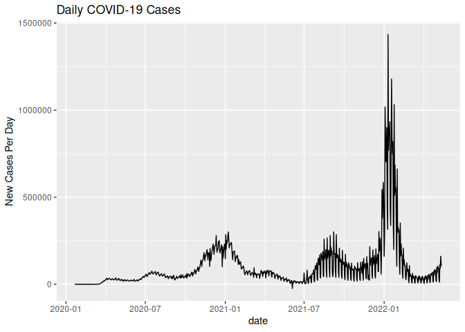<!-- -->
**Observations** - The first thing I wanted to do was just plot the data
to see if there was anything that interested me. - From the graph of new
cases, there seems to be three main spikes. Notably, the first one isn’t
until late 2020, early 2021. - This seemed weird to me as I remember how
huge of a deal the pandemic was in March of 2020. That felt like the
worst of the pandemic but looking at this graph, you wouldn’t think
that. - My next step that I wanted to take was to look at the start of
the pandemic to see if there was anything that happened at the start of
the pandemic that made everyone really scared and put the entire world
on hold.

``` r
df_state_daily <- df_normalized %>%
  filter(!is.na(cases)) %>%
  group_by(state, date) %>%
  summarize(cases = sum(cases), .groups = "drop_last") %>%
  group_by(state) %>%
  mutate(days_since_first = as.numeric(date - min(date))) %>%
  ungroup()
df_state_daily
```

    ## # A tibble: 44,363 × 4
    ##    state   date       cases days_since_first
    ##    <chr>   <date>     <dbl>            <dbl>
    ##  1 Alabama 2020-03-13     6                0
    ##  2 Alabama 2020-03-14    12                1
    ##  3 Alabama 2020-03-15    23                2
    ##  4 Alabama 2020-03-16    29                3
    ##  5 Alabama 2020-03-17    39                4
    ##  6 Alabama 2020-03-18    51                5
    ##  7 Alabama 2020-03-19    78                6
    ##  8 Alabama 2020-03-20   106                7
    ##  9 Alabama 2020-03-21   131                8
    ## 10 Alabama 2020-03-22   157                9
    ## # ℹ 44,353 more rows

``` r
state_pages <- df_state_daily %>%
  filter(cases <= 10000) %>%
  ggplot(aes(days_since_first, cases)) +
  geom_line()
state_pages + facet_wrap_paginate(~ state, nrow = 2, ncol = 5, page = 1)
```

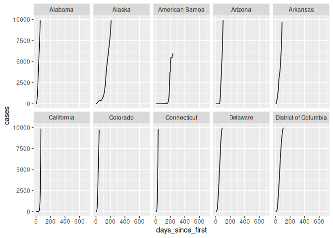<!-- -->

``` r
state_pages + facet_wrap_paginate(~ state, nrow = 2, ncol = 5, page = 2)
```

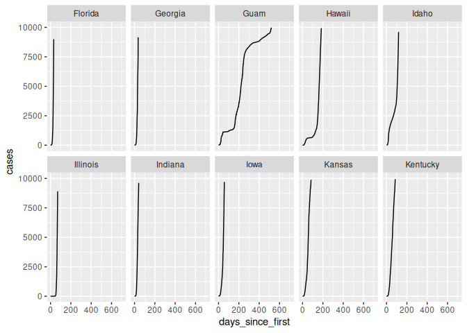<!-- -->

``` r
state_pages + facet_wrap_paginate(~ state, nrow = 2, ncol = 5, page = 3)
```

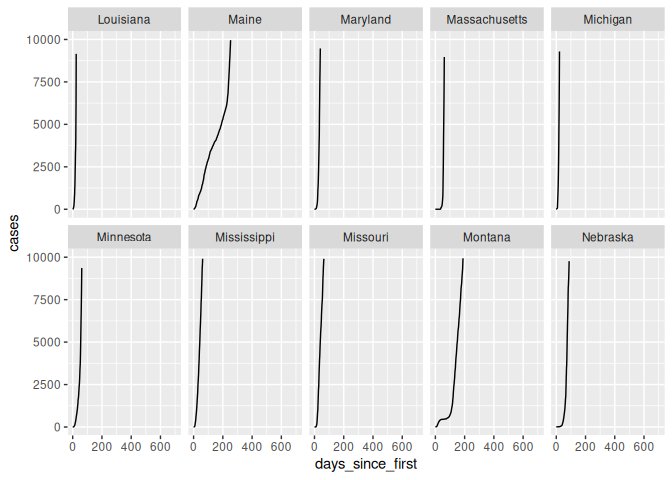<!-- -->

``` r
state_pages + facet_wrap_paginate(~ state, nrow = 2, ncol = 5, page = 4)
```

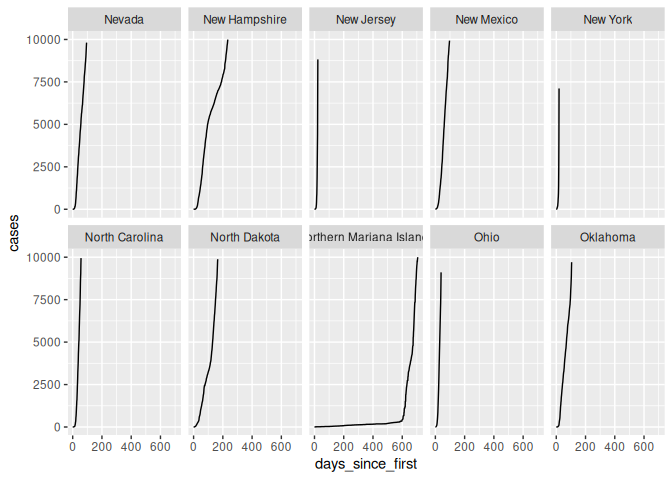<!-- -->

``` r
state_pages + facet_wrap_paginate(~ state, nrow = 2, ncol = 5, page = 5)
```

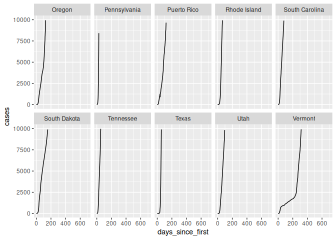<!-- -->

``` r
state_pages + facet_wrap_paginate(~ state, nrow = 2, ncol = 5, page = 6)
```

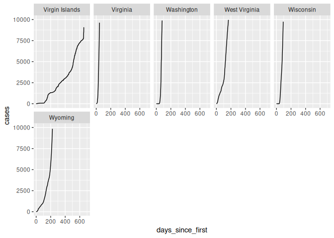<!-- -->
**Observations** - I looked at each state individually and checked to
see how quickly each state/territory got to 10,000 cases. - This seemed
to explain why there was such a big scare in the early days of the
pandemic. Even though the number of cases didn’t peak early on, the
number of cases shot up very rapidly and it seemed to be growing
unconstrained. - Notably there are a few states that seemed to do a good
job at containing it at first. Of course there were the Mariana Islands
and Virgin Islands that were isolated enough to contain the virus, but
also places with bigger populations like Connecticut, Hawaii, and
Montana - Hawaii caught my eye because it has an initial spike in cases,
and seems to handle it for a bit before spiking again. - Knowing that
Hawaii consists of several islands, my hypothesis is that one of the
smaller islands had a ton of cases, and once that was contained, it took
a little longer for the rest of the islands to catch it.

``` r
hawaii <- df_normalized %>%
  filter(
    state == "Hawaii", 
    !is.na(cases)
    ) %>%
  group_by(county) %>%
  mutate(new_cases  = cases  - lag(cases,  default = 0),
         new_deaths = deaths - lag(deaths, default = 0))
hawaii
```

    ## # A tibble: 3,982 × 11
    ## # Groups:   county [6]
    ##    date       county   state  fips  cases deaths population cases_per100k
    ##    <date>     <chr>    <chr>  <chr> <dbl>  <dbl>      <dbl>         <dbl>
    ##  1 2020-03-06 Honolulu Hawaii 15003     1      0     987638         0.101
    ##  2 2020-03-07 Honolulu Hawaii 15003     1      0     987638         0.101
    ##  3 2020-03-08 Honolulu Hawaii 15003     2      0     987638         0.203
    ##  4 2020-03-09 Honolulu Hawaii 15003     2      0     987638         0.203
    ##  5 2020-03-10 Honolulu Hawaii 15003     2      0     987638         0.203
    ##  6 2020-03-11 Honolulu Hawaii 15003     2      0     987638         0.203
    ##  7 2020-03-12 Honolulu Hawaii 15003     2      0     987638         0.203
    ##  8 2020-03-13 Honolulu Hawaii 15003     2      0     987638         0.203
    ##  9 2020-03-14 Honolulu Hawaii 15003     2      0     987638         0.203
    ## 10 2020-03-14 Kauai    Hawaii 15007     2      0      71377         2.80 
    ## # ℹ 3,972 more rows
    ## # ℹ 3 more variables: deaths_per100k <dbl>, new_cases <dbl>, new_deaths <dbl>

``` r
hawaii %>%
  ggplot(aes(date, new_cases)) +
  geom_line()
```

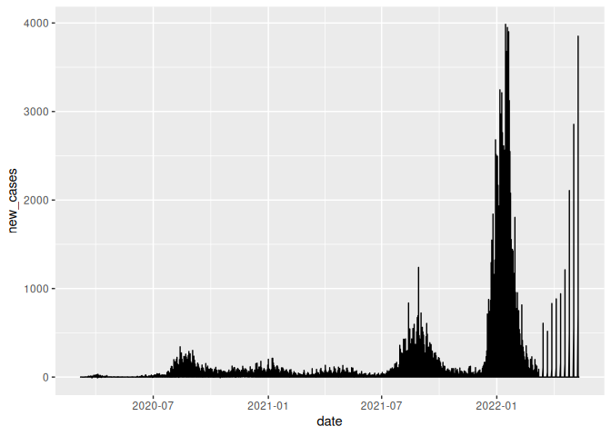<!-- -->
**Observations** - I did something very similar with just Hawaii’s data
as I did with all of the states, and plotted the number of new cases per
day - It seems to show three major spikes like the general data. The
first spike seems to come a little sooner. - There is a tiny spike at
the start that could explain the bump I saw in the “days since first
case vs. cases” graph. - There is a larger spacing in data at the end.
This is likely because Hawaii stopped recording its data everyday and
started recording its data weekly, or bi-daily, or something like that.
That would also explain why there seems to be a fourth spike.

``` r
hawaii %>%
  filter(cases <= 10000,
         county != "Unknown",
         county != "Kalawao") %>%
  ggplot(aes(date, new_cases, color = county)) + 
  geom_line()
```

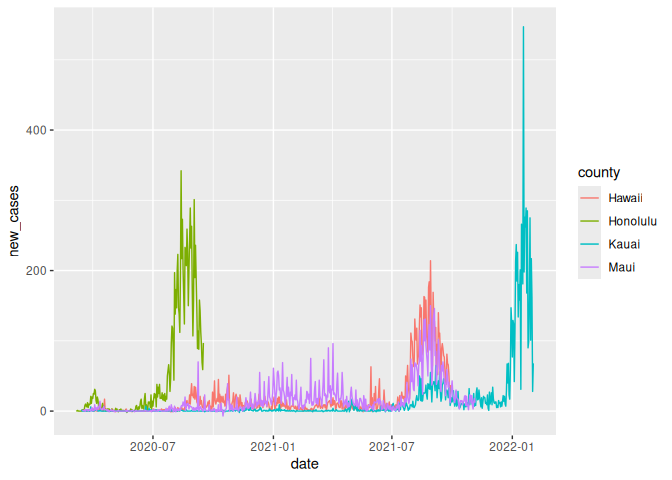<!-- -->
**Observation** - This graph shows that the different islands peak at
different times, which supports the claim that one island got it before
the rest of the islands got it. - However, these peaks all happen well
after the dates of the first reported cases. - Their peaks are also
coorelated with population. Honolulu has the highest population of
almost a million, Hawaii and Maui have a population between 150,000 and
250,00 and Kauai has a population of ~75,000. Kalawao was not included
because it has a county population of 82 people.

``` r
hawaii %>%
  filter(
         county != "Unknown",
         county != "Kalawao") %>%
  ggplot(aes(date, cases, color = county)) +
  geom_line()
```

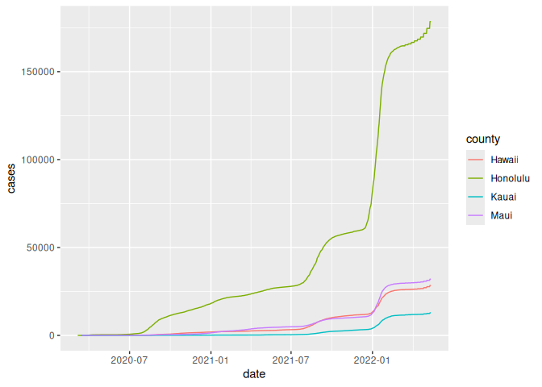<!-- -->
**Observation** - This graph supports that the peaks show more of a
population trend rather than the virus jumping from island to island. -
Honolulu county has all three peaks, Maui and Hawaii have the second and
third peaks, and Kauai has the third peak. - This suggest that the third
wave of Covid spread the most, the second wave spread the next most, and
the first wave spread the least. - This is supported by the data in the
first graph showing the general trends of Covid across the United
States. - I still wanted to figure out why there was the initial hump in
the days since first case vs. cases” graph. - I looked at this story:
<https://www.politico.com/news/magazine/2020/06/19/hawaii-covid-success-story-322919>. -
It was published on June 19th, 2020, and although it prematurely
celebrates Hawaii as a Covid-19 success story, it does talk about how
well Hawaii did at containing Covid at the start of the pandemic. - It
cites the 14-day quarantine requirement and early tracking of cases as
causes for why Hawaii did so well. It also does help that it’s an
isolated island. \### Aside: Some visualization tricks
<!-- ------------------------- -->

These data get a little busy, so it’s helpful to know a few `ggplot`
tricks to help with the visualization. Here’s an example focused on
Massachusetts.

``` r
## NOTE: No need to change this; just an example
df_normalized %>%
  filter(
    state == "Massachusetts", # Focus on Mass only
    !is.na(fips), # fct_reorder2 can choke with missing data
  ) %>%

  ggplot(
    aes(date, cases_per100k, color = fct_reorder2(county, date, cases_per100k))
  ) +
  geom_line() +
  scale_y_log10(labels = scales::label_number()) +
  scale_color_discrete(name = "County") +
  theme_minimal() +
  labs(
    x = "Date",
    y = "Cases (per 100,000 persons)"
  )
```

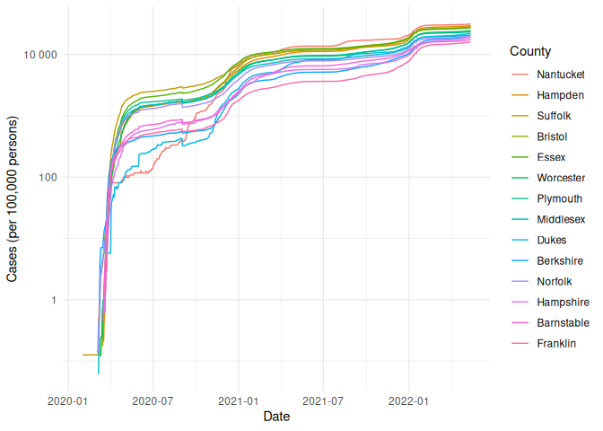<!-- -->

*Tricks*:

- I use `fct_reorder2` to *re-order* the color labels such that the
  color in the legend on the right is ordered the same as the vertical
  order of rightmost points on the curves. This makes it easier to
  reference the legend.
- I manually set the `name` of the color scale in order to avoid
  reporting the `fct_reorder2` call.
- I use `scales::label_number_si` to make the vertical labels more
  readable.
- I use `theme_minimal()` to clean up the theme a bit.
- I use `labs()` to give manual labels.

### Geographic exceptions

<!-- ------------------------- -->

The NYT repo documents some [geographic
exceptions](https://github.com/nytimes/covid-19-data#geographic-exceptions);
the data for New York, Kings, Queens, Bronx and Richmond counties are
consolidated under “New York City” *without* a fips code. Thus the
normalized counts in `df_normalized` are `NA`. To fix this, you would
need to merge the population data from the New York City counties, and
manually normalize the data.

# Notes

<!-- -------------------------------------------------- -->

\[1\] The census used to have many, many questions, but the ACS was
created in 2010 to remove some questions and shorten the census. You can
learn more in [this wonderful visual
history](https://pudding.cool/2020/03/census-history/) of the census.

\[2\] FIPS stands for [Federal Information Processing
Standards](https://en.wikipedia.org/wiki/Federal_Information_Processing_Standards);
these are computer standards issued by NIST for things such as
government data.

\[3\] Demographers often report statistics not in percentages (per 100
people), but rather in per 100,000 persons. This is [not always the
case](https://stats.stackexchange.com/questions/12810/why-do-demographers-give-rates-per-100-000-people)
though!
